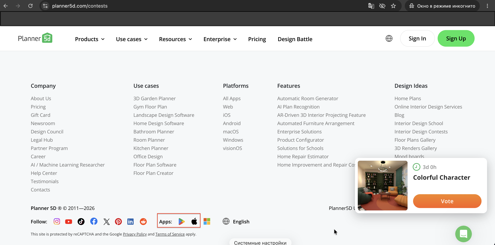

# [UI] Apple App Store and Google Play icons do not comply with official brand guidelines

| Field           | Value                                                |
| --------------- | ---------------------------------------------------- |
| **ID**          | BUG-001                                              |
| **Environment** | macOS, Chrome (157.0.8103.78), window size 1920x1080 |
| **Date**        | 12.11.2026                                           |
| **Priority**    | Medium                                               |

## Steps

1. Open https://planner5d.com in a desktop browser
2. Scroll to the footer
3. Check the "Apps:" section

## Actual result

The Apple and Google Play links are displayed as small mobile-sized logos instead of the official store badges

## Expected result

The Apple App Store and Google Play links use the official badges from the Apple and Google Play brand guidelines, in a size suitable for desktop
 https://developer.apple.com/app-store/marketing/guidelines/
 https://partnermarketinghub.withgoogle.com/brands/google-play/google-play/lockups-icons-badges/#badges

## Screenshot

## Notes

- Microsoft Store icon was not checked against its guidelines
