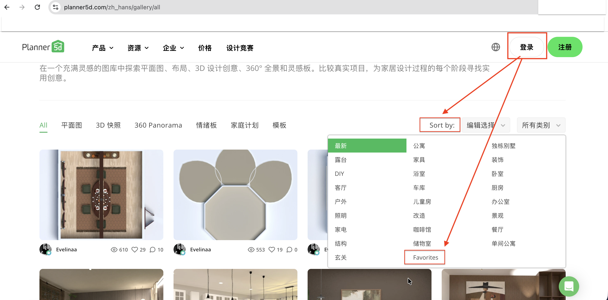

# [UI][Localization] "Sort by" label and "Favorites" category are not localized on Gallery page

| Field           | Value                                                |
| --------------- | ---------------------------------------------------- |
| **ID**          | BUG-002                                              |
| **URL**         | https://planner5d.com/gallery/all                    |
| **Environment** | macOS, Chrome (157.0.8103.78), window size 1920x1080 |
| **Date**        | 12.11.2026                                           |
| **Priority**    | Low                                                  |

## Steps to reproduce

1. Open https://planner5d.com/gallery/all
2. Change site language to any language other than English using the language switcher
3. Check "Sort by" label above the gallery
4. Open "All categories" dropdown and check "Favorites" item

## Actual result

"Sort by" label and "Favorites" item in the category list are not localized and remain in English, while the other dropdown options and the rest of the interface are translated

## Expected result

"Sort by" label and "Favorites" item are localized to the selected language, like the other interface elements

## Screenshot

## Notes

Reproduced in all available languages except English
